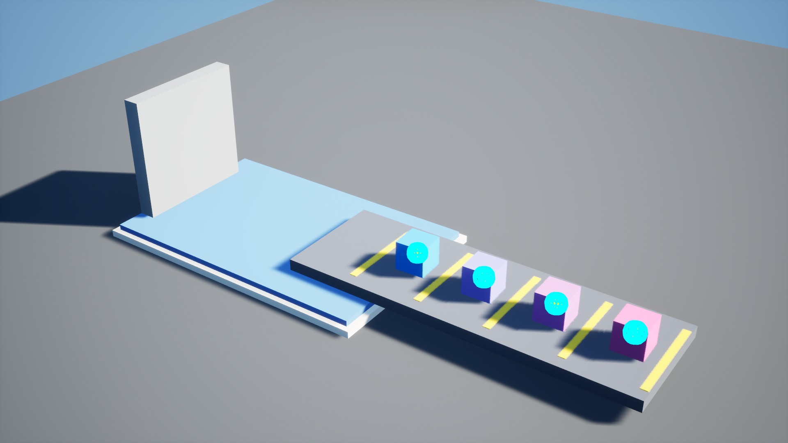

# Mass Inspector

**Free on Fab: coming soon**

Version: **1.0.0**. This public repository contains documentation and demo media. The plugin is distributed separately through Fab. Demo video: [media/MassInspector_demo_1920x1080.mp4](media/MassInspector_demo_1920x1080.mp4).

A free Unreal Engine 5.8 runtime code plugin for inspecting physics mass and center of mass in PIE and running games. Target platform: Win64. No content assets are required.

## Installation

1. Copy the complete `MassInspector` directory into `<Project>/Plugins/MassInspector`.
2. Close the editor, regenerate project files if applicable, and build the project's Win64 Development Editor target with the UE 5.8 C++ toolchain. Source-only distribution requires a compiler, including for Blueprint projects.
3. Enable **Mass Inspector** under **Edit > Plugins > Physics**, then restart if requested.

There is one `Runtime` module, loaded at `Default`. Its only declared dependencies are `Core`, `CoreUObject`, and `Engine`. No project settings, third-party libraries, GameMode, or assets are required.

## Blueprint quick start: three steps

1. Add **MassInspectorComponent** to an actor with a registered primitive component and collision. Enable **Simulate Physics** on that primitive.
2. Play in Editor. Cyan points and labels show each unique default body's mass and world center of mass; a green sphere shows the actor's combined center. Set `bDrawSupportProjection` or `bDrawVelocity` to see the ground projection or velocity arrows.
3. Read **Get Total Mass**, **Get Combined Center Of Mass**, **Get Body Count**, or **Get Body Snapshot** in Blueprint. Use `MassInspector.Show 1` in the console to inspect other simulating actors without attaching components.

## Console commands

| Command | Default | Behavior |
| --- | --- | --- |
| `MassInspector.Show 0/1` | 0 | Toggle yellow center points and cyan 16 cm wire spheres for all matching simulating default bodies. |
| `MassInspector.MaxBodies N` | 256 | Display at most N unique bodies, nearest world CoM to the first local player camera first. Runtime clamp: 0-16384; 0 draws nothing. |
| `MassInspector.Labels 0/1` | 0 | Toggle component-name and mass labels for the world overlay. |
| `MassInspector.Filter Crate` | All | Case-insensitive substring of the actor's UObject name, such as `BP_Crate_C_0`; does not use the editor display label. |
| `MassInspector.Filter *` | All | Reset the actor-name filter. |

These controls are process-wide and affect every Game/PIE world, including multiple PIE clients. They do not change attached inspector components. Without a local player camera, distance is measured from world zero. Commands and overlay code are excluded from Shipping. Dedicated servers do not draw or scan for the overlay.

The overlay uses the local player camera manager directly, so spectator pawns and auto-activated CameraActors work without a possessed pawn. It redraws while paused. Markers use foreground depth to remain visible through the inspected mesh, with 12 px points and 2.5 px sphere lines. They are world-space geometry and do not require HUD labels to appear in movie captures.

Device profiles and startup overrides are supported, for example `-DPCVars=MassInspector.Show=1,MassInspector.Labels=1`. The variables deliberately use `ECVF_Default`: marking late-registered variables as cheats would make UE discard deferred device-profile values. Each world logs `Overlay enabled` once per off/on transition, with the number of unique bodies found, the drawing cap result, and the Show variable's source. The count describes the activation frame; bodies spawned later are discovered on subsequent ticks.

## Component properties

| Property | Default | Meaning |
| --- | --- | --- |
| `UpdateInterval` | 0.1 s | Collection interval; 0 collects every frame. Tick runs after physics; drawing refreshes every frame using the latest snapshot. |
| `bSimulatingOnly` | true | Exclude non-simulating bodies. Sleeping simulated bodies remain included. |
| `bDrawDebug` | true | Master drawing toggle; data collection continues when false. |
| `bDrawBodyCenters` / `bDrawMassLabels` | true / true | Per-body center points and component-name/mass labels. |
| `bDrawCombinedCenter` | true | Wire sphere at the actor's mass-weighted center. |
| `bDrawSupportProjection` | false | Trace from the combined center along world -Z, ignoring the owning actor. Draw a line and hit point only on a blocking hit and with positive total mass. |
| `bDrawVelocity` | false | Linear velocity arrows for simulating bodies. |
| `BodyColor` / `CombinedColor` | Cyan / Green | Per-body point/label and combined sphere colors. |
| `SupportColor` / `VelocityColor` | Yellow / Magenta | Support trace and arrow colors. |
| `BodyPointSize` | 12 | Debug point size in screen pixels; also used for support hit points. |
| `CombinedSphereRadius` | 16 cm | Combined center sphere radius. |
| `LineThickness` | 2.5 | Sphere, support line, and arrow thickness. |
| `LabelHeight` / `LabelScale` | 15 cm / 1 | World Z offset and font scale. |
| `VelocityScale` / `VelocityArrowSize` | 0.1 s / 10 cm | Arrow endpoint = CoM + velocity * scale; arrowhead size. |
| `GroundTraceDistance` / `GroundTraceChannel` | 1000 cm / Visibility | Maximum downward distance and collision channel. |

Negative or non-finite intervals and sizes are treated as zero at runtime. Drawings are non-persistent, last one frame, and stop on the next frame after disabling an option or destroying the inspector. Zero point size, sphere radius, or font scale suppresses that element.

## Blueprint functions

| Class / function | Behavior |
| --- | --- |
| Component: `GetTotalMass()` | Cached total in kg; 0 before the first sample or without positive mass. |
| Component: `GetCombinedCenterOfMass()` | Cached world center in cm; current owning actor location when total mass is 0, or zero without an owner. |
| Component: `GetBodyCount()` | Number of unique sampled default bodies, including bodies with zero available mass when not filtering them out. |
| Component: `GetBodySnapshot()` | Copy of the cached `FMassInspectorBodyInfo` array; no object references. Copying the array can allocate. |
| Component: `RefreshSnapshot()` | Collect immediately, including before BeginPlay if the owner's primitives are registered; restart the collection interval. |
| Library: `ComputeCombinedCenterOfMass(Components, OutTotalMass)` | Query registered components now, including non-simulating bodies; skip null entries and duplicate/welded body identities. Return zero with total 0 if there is no positive mass. |
| Library: `GetActorPhysicsMass(Actor)` | Query all of the actor's registered default bodies now, with the same fallback and deduplication. Null actor returns 0. |
| Library: `ComputeCenterOfMassFromMasses(Masses, Positions, OutTotalMass)` | Physics-independent pure math. Pair entries through the shorter array; ignore unpaired entries, non-positive/non-finite masses and non-finite positions. |
| Library: `DrawCenterOfMass(WorldContextObject, WorldCenterOfMass, Radius, Color, Duration)` | Draw a non-persistent wire sphere, default radius 12 cm and green. Duration 0 means one frame. Invalid context/position returns safely; Shipping is a no-op. |

`FMassInspectorBodyInfo` exposes `ComponentName` (FName), `MassKg` (float), `WorldCenterOfMass` (FVector, cm), `LinearVelocity` (FVector, cm/s), and `bSimulating` (bool), all Blueprint read-only. Defaults are None, 0, zero, zero, and false. Names identify components on their owning actor; they are not globally unique.

## Sampling and lifetime

Each registered primitive contributes the default `GetBodyInstance()` result. A valid simulating body supplies live BodyInstance mass, world CoM and linear velocity. With `bSimulatingOnly = false`, a non-simulating body instead uses **component bounds origin**, zero velocity, and its live BodyInstance mass when available. If no live positive mass is available, an explicit BodyInstance mass override is used; otherwise mass is 0. A missing body instance is skipped. No geometric mass estimate is invented, and physics-actor reads are guarded by body validity.

Repeated pointers and welded components sharing one BodyInstance count once per query. The snapshot uses one representative component name. A welded compound can include shapes owned by other actors: its reported mass belongs to the whole compound, so do not add separate actors' totals together across a weld.

```text
TotalMass = sum(positive finite Mass[i])
CombinedCenterOfMass = sum(Mass[i] * WorldCenter[i]) / TotalMass
```

Accumulation uses doubles. Invalid positions contribute neither mass nor position. A total beyond the float output range or a non-finite accumulation resets the result to total 0 and the documented fallback location.

The component samples at BeginPlay and at the configured interval; getters do not trigger physics reads. Component creation/removal is discovered at the next sample. Getters remain functional in Shipping. Use these APIs on the game thread. Snapshots can be up to one collection interval old, including after a body is destroyed or moved.

The subsystem scans the current world's loaded levels and registered actor primitives only while enabled, deduplicates and sorts in place, and caps the displayed results. Discovery includes runtime spawns, streamed levels, and changed simulation state on the next tick. Sorting is O(B log B) in matching component count; the drawing cap does not cap discovery work. Collector arrays and formatting buffers retain their high-water capacity, avoiding collector allocations after warm-up for a stable scene. Scene growth or longer names can grow storage. No body/component reference is retained across queries, and world teardown releases subsystem storage.

The Engine's DrawDebug renderer and HUD text path own their internal allocations; enabling `DrawDebugString` labels can allocate there each frame even after collector warm-up. Labels require a local player HUD with debug text enabled; points and spheres do not. No global debug-string flush is used, so other tools' output is preserved.

API signatures were checked against installed UE 5.8 headers and Epic's [BodyInstance](https://dev.epicgames.com/documentation/unreal-engine/API/Runtime/Engine/FBodyInstance?application_version=5.8) and [Tickable World Subsystem](https://dev.epicgames.com/documentation/unreal-engine/API/Runtime/Engine/UTickableWorldSubsystem) references.

## Limitations

- One default/root body per primitive component. Skeletal physics assets, instanced meshes, Geometry Collections, and custom components with multiple bodies are not enumerated bone by bone or instance by instance.
- The support projection is a world-down blocking trace, not a contact solver, support polygon, stability estimate, or gravity-direction query. No hit draws no projection.
- Debug drawing is guarded by `!UE_BUILD_SHIPPING` and `ENABLE_DRAW_DEBUG`, including in Development and Development Editor builds. No idle editor viewport preview or dedicated-server visualization is supplied.
- The tool reads physics state and draws debug geometry; it applies no forces or mass changes. There is no replication, network authority management, recording, UI, or persistent history.
- Supported target: UE 5.8 / Win64. Overlay validation covered Development and Development Editor compilation, all seven automation tests (including Game/PIE world ticking), and a 1920x1080 `-game -dumpmovie` capture with labels disabled.

## Automation and in-engine verification

Tests are under `Private/Tests`, guarded by `WITH_DEV_AUTOMATION_TESTS`. In Session Frontend > Automation, run `MassInspector`, or use `Automation RunTests MassInspector` in the editor console. The six `MassInspector.Core` tests cover a known 3D weighted center, zero/empty mass fallback, null library entries, snapshot defaults, invalid/unpaired/overflow math inputs, and deferred device-profile CVar registration. `MassInspector.Overlay.GameAndPIE` creates Game and PIE worlds with a physics-simulating engine cube and no player controller, checks actual tick registration and foreground geometry without labels, and verifies paused redraws and off/on toggling.

After building, check a two-body actor with unequal masses, an empty actor's location fallback, sleeping bodies, non-simulating bounds/override fallback, weld deduplication, runtime spawn/destruction, a support trace hit/miss, and velocity direction. In the world overlay, check nearest-camera capping, filtering, labels and disabling, streamed levels, multiple PIE worlds, and world teardown. Verify Blueprint getters in Shipping and absence of plugin debug drawing/console controls there.

## Support

Author: **Andac Senyucel**. Documentation: [github.com/Andacs/MassInspector](https://github.com/Andacs/MassInspector). Report issues at [MassInspector/issues](https://github.com/Andacs/MassInspector/issues) or through the support channel shown on Fab when published. Include plugin/UE versions, Win64 build configuration, minimal component setup, relevant log output, and reproduction steps. Do not include private project assets or credentials.

From the same author: Weight Balance Platform, mass-driven tilting platforms on Fab.
